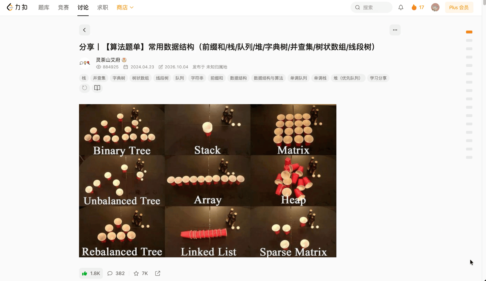

# 力扣讨论 · 文章目录

一个为力扣讨论文章添加悬浮目录的油猴脚本，方便阅读长文和算法题单，快速找到想看的章节。

## 有什么用

- 鼠标悬停右侧小方块展开目录，移开后自动收起。
- 点击章节即可跳转，支持搜索和多级目录折叠。
- 自动高亮当前阅读的章节，支持深浅色模式。

## 使用演示

## 安装使用

1. 在浏览器安装 [Tampermonkey（篡改猴）](https://www.tampermonkey.net/)。
2. 打开 [Greasy Fork 脚本页面](https://greasyfork.org/zh-CN/scripts/601597)，点击「安装此脚本」并按提示确认。
3. 打开或刷新一篇力扣讨论文章，将鼠标移到右侧的小方块上即可使用目录。

**建议配合 [0x3f-problem-solution](https://greasyfork.org/zh-CN/scripts/501134-0x3f-problem-solution) 脚本的「关闭右侧讨论区」功能使用。**

脚本仅在具体文章页生效，讨论首页不显示目录。如果从首页进入文章后没有出现目录，刷新页面即可。

需要更新时，前往同一个 [Greasy Fork 脚本页面](https://greasyfork.org/zh-CN/scripts/601597) 安装最新版本，完成后刷新文章页。

许可证：[MIT](./LICENSE)。
